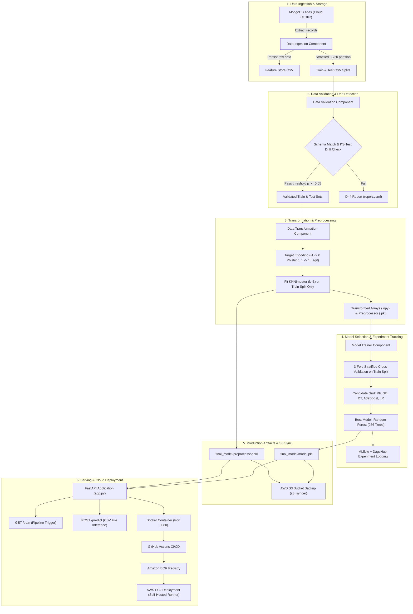

## 📌 Executive Overview

The **Network Security Phishing Detection System** is an enterprise-grade, end-to-end Machine Learning Operations (MLOps) platform engineered to detect malicious and phishing URLs in real time. Phishing remains one of the primary attack vectors in modern cybersecurity, accounting for widespread credential harvesting and data breaches.

This system bridges the gap between academic machine learning and resilient production engineering by delivering:
- A modular data pipeline featuring **MongoDB Atlas** ingestion, automated **data drift detection** (two-sample Kolmogorov-Smirnov test), and leakage-free **KNN imputation**.
- A test-independent cross-validation model selection framework across 5 candidate architectures, crowned by a high-precision **Random Forest Classifier** achieving **97.38% test accuracy** and **99.78% ROC-AUC**.
- Remote experiment tracking via **MLflow and DagsHub**, automated **AWS S3** artifact backup, and containerized **FastAPI** inference.
- An automated **GitHub Actions CI/CD pipeline** driving continuous integration, Docker image publishing to **Amazon ECR**, and continuous deployment on an **AWS EC2** self-hosted runner.

---

## 🏗️ System Architecture



---

## ⚡ Key Capabilities & Features

### 1. Robust Data Pipeline & Ingestion
- **Cloud Database Integration:** Ingests raw network traffic and website feature datasets directly from **MongoDB Atlas** using TLS encryption and certificate verification.
- **Reproducible Data Partitioning:** Implements stratified splitting into training ($80\%$) and testing ($20\%$) subsets, maintaining exact class ratios across environments.
- **Feature Store Automation:** Preserves immutable raw copies in a designated feature store for lineage tracking and compliance.

### 2. Validation & Statistical Drift Monitoring
- **Schema Enforcement:** Validates schema column count and types against strict YAML specifications ([`data_schema/schema.yaml`](file:///c:/Users/Omkar%20Kadam/Music/networksecurity/data_schema/schema.yaml)).
- **Distribution Drift Detection:** Applies the **two-sample Kolmogorov-Smirnov test (`ks_2samp`)** across all 30 features between baseline training and incoming data, logging $p$-values and drift alerts into structured YAML reports.

### 3. Leakage-Free Preprocessing Pipeline
- **KNN Imputation:** Handles potential missing feature values using a 3-nearest-neighbors imputer (`KNNImputer(n_neighbors=3, weights='uniform')`).
- **Zero Data Leakage:** Imputer is strictly fitted on the training split only and applied downstream to evaluation and inference sets.
- **Domain-Specific Encoding:** Maps the raw dataset target (`-1` Phishing, `1` Legitimate) to standard binary labels (`0` Phishing, `1` Legitimate) while preserving semantic transparency.

### 4. Rigorous Model Selection & Experiment Tracking
- **Multi-Model Benchmark:** Systematically optimizes and evaluates 5 candidate classifiers: Random Forest, Gradient Boosting, Decision Tree, AdaBoost, and Logistic Regression.
- **Test-Independent CV Selection:** Employs 3-fold stratified cross-validation on training data to select the optimal model, keeping the test set pristine until final verification.
- **MLflow & DagsHub Synchronization:** Automatically tracks hyperparameters, precision, recall, and F1-scores remotely on DagsHub.

### 5. Production Serving & Deployment
- **FastAPI Endpoints:** Exposes asynchronous REST endpoints for remote retraining (`/train`) and batch CSV prediction (`/predict`) with interactive Swagger documentation (`/docs`).
- **Docker Containerization:** Fully containerized with a lightweight Python 3.10 slim base image.
- **CI/CD to AWS:** GitHub Actions automatically builds, tags, and pushes Docker containers to **Amazon ECR** and triggers rolling deployments on an **AWS EC2** instance via a self-hosted runner.

---

## 🔬 Machine Learning Evaluation & Results

The system was evaluated using an untouched, held-out stratified test set ($N = 2,211$) from the 11,055-sample phishing dataset.

### Candidate Models Comparison (3-Fold CV vs. Test Set)

| Candidate Model | Best Hyperparameters | Training CV Macro F1 | Test Accuracy | Test Phishing F1 (0) | Test Legit F1 (1) | Test Macro F1 | Test ROC-AUC |
| :--- | :--- | :---: | :---: | :---: | :---: | :---: | :---: |
| 🏆 **Random Forest** | `n_estimators: 256` | **0.9684** | **97.38%** | **97.02%** | **97.66%** | **0.9734** | **0.9978** |
| **Decision Tree** | `criterion: 'entropy'` | 0.9552 | 97.42% | 97.07% | 97.70% | 0.9738 | 0.9830 |
| **Gradient Boosting** | `learning_rate: 0.2, n_est: 256, subsample: 1.0` | 0.9624 | 96.43% | 95.94% | 0.9681 | 0.9637 | 0.9959 |
| **AdaBoost** | `learning_rate: 1.0, n_est: 256` | 0.9346 | 93.40% | 92.43% | 0.9415 | 0.9329 | 0.9882 |
| **Logistic Regression** | `C: 0.1` | 0.9270 | 93.26% | 92.25% | 0.9404 | 0.9314 | 0.9806 |

---

### Selected Best Model: Random Forest Classifier

- **Architecture:** `RandomForestClassifier(n_estimators=256, random_state=42)`
- **Evaluation Records:** 8,844 training records | 2,211 held-out test records

| Metric Dimension | Decimal Score | Percentage | Operational Meaning |
| :--- | :---: | :---: | :--- |
| **Overall Accuracy** | `0.9738` | **97.38%** | Proportion of all websites correctly classified |
| **Phishing Precision (Pos = 0)** | `0.9772` | **97.72%** | Confidence that flagged URLs are truly malicious |
| **Phishing Recall (Pos = 0)** | `0.9633` | **96.33%** | Detection rate of actual phishing attacks |
| **Phishing F1-Score (Pos = 0)** | `0.9702` | **97.02%** | Harmonic mean of detection rate & precision |
| **Legitimate Precision (Pos = 1)** | `0.9711` | **97.11%** | Safety rate of approved URLs |
| **Legitimate Recall (Pos = 1)** | `0.9821` | **98.21%** | Proportion of legitimate traffic allowed through |
| **Legitimate F1-Score (Pos = 1)** | `0.9766` | **97.66%** | Balance of legitimate site recognition |
| **Macro Average F1** | `0.9734` | **97.34%** | Unweighted mean performance across both classes |
| **ROC-AUC Score** | `0.9978` | **99.78%** | Near-perfect class separability across all thresholds |

---

### Confusion Matrix (Held-Out Test Set)

```text
                     Predicted: Phishing (0)   Predicted: Legitimate (1)
Actual: Phishing (0)           944 (TP)                    36 (FN)
Actual: Legit (1)               22 (FP)                  1209 (TN)
```

- **True Positives (TP - Phishing Intercepted):** `944` malicious websites neutralized.
- **False Negatives (FN - Phishing Missed):** `36` attacks bypassed detection (false negative rate of only `3.67%`).
- **False Positives (FP - False Alarm):** `22` legitimate websites misflagged (false alarm rate of only `1.79%`).
- **True Negatives (TN - Clean Sites Passed):** `1,209` benign websites allowed without interruption.

---

## 🛠️ Technology Stack

| Category | Technology | Purpose & Responsibility |
| :--- | :--- | :--- |
| **Core & Environment** | **Python 3.10** | Core programming language across pipeline, modeling, and API |
| **Machine Learning** | **scikit-learn** | Model algorithms (RF, GB, DT, AdaBoost, LR), imputation, metrics |
| | **NumPy & Pandas** | High-performance numerical computations and data manipulation |
| | **SciPy** | Two-sample Kolmogorov-Smirnov statistical tests for data drift |
| **API & Web Framework**| **FastAPI** | High-performance async REST API for serving and predictions |
| | **Uvicorn** | Production-ready ASGI web server |
| | **Jinja2** | Template rendering engine for prediction result tables |
| **Database & Storage** | **MongoDB Atlas** | Managed cloud NoSQL database storing raw network security records |
| | **PyMongo & Certifi**| Python driver with SSL/TLS certificate handling for database connectivity |
| **Experiment Tracking**| **MLflow** | Logging parameters, training/test metrics, and model artifacts |
| | **DagsHub** | Hosted remote MLflow server and repository collaboration platform |
| **Cloud Infrastructure**| **Amazon S3** | Cloud object storage for timestamped pipeline and model artifacts |
| | **Amazon ECR** | Elastic Container Registry for secure Docker image management |
| | **Amazon EC2** | Compute instance hosting self-hosted runner and Dockerized app |
| **DevOps & CI/CD** | **Docker** | Containerization of the application and its dependency environment |
| | **GitHub Actions** | Automated CI (lint/tests) and CD (ECR push & EC2 deployment) |

---

## 📁 Repository Structure

```text
networksecurity/
│
├── .github/
│   └── workflows/
│       └── main.yml               # GitHub Actions CI/CD pipeline (ECR & EC2)
│
├── data_schema/
│   └── schema.yaml                # Schema definitions and expected column types
│
├── Network_data/
│   ├── phisingData.csv            # Original labeled dataset (11,055 samples)
│   └── phisingData_predict.csv    # Feature data for batch prediction verification
│
├── Valid_data/
│   └── test.csv                   # Sample input test data for API verification
│
├── networksecurity/               # Core Python Package
│   ├── cloud/
│   │   └── s3_syncer.py           # AWS S3 synchronization utilities
│   ├── components/
│   │   ├── data_ingestion.py      # MongoDB extraction & train/test splitting
│   │   ├── data_validation.py     # Schema validation & KS drift detection
│   │   ├── data_transformation.py # Target encoding & KNN imputation
│   │   └── model_trainer.py       # Grid search, MLflow tracking & model export
│   ├── constant/
│   │   └── training_pipeline/     # Pipeline constants, paths, and thresholds
│   ├── entity/
│   │   ├── config_entity.py       # Configuration dataclasses
│   │   └── artifact_entity.py     # Component output dataclasses
│   ├── exception/
│   │   └── exception.py           # Custom exception handling with line/file tracing
│   ├── logging/
│   │   └── logger.py              # Centralized logging configuration
│   ├── pipeline/
│   │   └── training_pipeline.py   # Orchestrator for end-to-end training
│   └── utils/
│       ├── main_utils/utils.py    # YAML, pickle, and numpy array utilities
│       └── ml_utils/              # NetworkModel wrapper & classification metrics
│
├── final_model/                   # Production-ready serialized artifacts
│   ├── model.pkl                  # Trained Random Forest Classifier (256 trees)
│   └── preprocessor.pkl           # Fitted KNNImputer pipeline
│
├── templates/
│   └── table.html                 # HTML template for rendering tabular predictions
│
├── evaluation_results/            # Generated model evaluation outputs
│   ├── best_model_metrics.txt     # Complete evaluation report with class metrics
│   ├── model_comparison.csv       # Comparative benchmark table of all candidate models
│   └── confusion_matrix.png       # Annotated confusion matrix plot
│
├── app.py                         # FastAPI web application entrypoint
├── evaluate_best_model.py         # Standalone reproducible model evaluation script
├── push_data.py                   # Script to push local CSV data into MongoDB Atlas
├── predict_test.py                # Standalone script for running predictions
├── test_mongo.py                  # MongoDB connectivity diagnostic script
├── requirements.txt               # Project dependencies
├── Dockerfile                     # Docker container configuration
├── setup.py                       # Package setup and distribution file
└── README.md                      # Project documentation
```

---

## 🚀 Getting Started & Local Installation

### Prerequisites
- **Python:** 3.10.x
- **Git**
- **Docker** *(optional, for containerized execution)*
- **MongoDB Atlas Account** *(for data ingestion)*
- **AWS CLI** *(configured with credentials for S3 artifact sync)*

### 1. Clone the Repository
```bash
git clone https://github.com/Omkar985087/networksecurity.git
cd networksecurity
```

### 2. Set Up Virtual Environment
```bash
# Using standard Python venv
python -m venv .venv

# Activate on Windows CMD / PowerShell
.venv\Scripts\activate

# Activate on Linux / macOS
source .venv/bin/activate
```

### 3. Install Dependencies
```bash
pip install --upgrade pip
pip install -r requirements.txt
```

### 4. Configure Environment Variables
Create a `.env` file in the project root directory with your credentials:

```ini
# MongoDB Atlas Configuration
MONGO_USER="your_mongo_username"
MONGO_PASS="your_mongo_password"
MONGO_CLUSTER="cluster0.vehgjny.mongodb.net"
MONGO_DB="OMKAR"

# AWS Configuration (Optional for cloud sync)
AWS_ACCESS_KEY_ID="your_aws_access_key"
AWS_SECRET_ACCESS_KEY="your_aws_secret_key"
AWS_REGION="us-east-1"
```

---

## 💻 Usage & Execution Guide

### 1. Ingest Data into MongoDB
To push raw CSV records into your MongoDB Atlas collection:
```bash
python push_data.py
```

### 2. Execute Model Evaluation Script
To run test-independent cross-validation across all candidate models, evaluate on the held-out test split, and generate comparison metrics and plots:
```bash
python evaluate_best_model.py
```
This generates:
- `evaluation_results/best_model_metrics.txt`
- `evaluation_results/model_comparison.csv`
- `evaluation_results/confusion_matrix.png`

### 3. Run Standalone Batch Predictions
To run inference on `Valid_data/test.csv` using the production model:
```bash
python predict_test.py
```
Predictions are output to `prediction_output/test_predictions.csv`.

### 4. Launch the FastAPI Application
```bash
python app.py
```
The server will start at `http://localhost:8000` (or `http://localhost:8080` in Docker).

---

## 🌐 API Reference & Endpoints

| Method | Endpoint | Description | Sample Request / Format |
| :---: | :--- | :--- | :--- |
| `GET` | `/` | Redirects to interactive API documentation | Browser visit |
| `GET` | `/docs` | Interactive Swagger UI API documentation | Browser visit |
| `GET` | `/train` | Triggers the complete training pipeline and S3 sync | `curl -X GET http://localhost:8000/train` |
| `POST`| `/predict`| Uploads CSV file, executes predictions, and renders HTML | `curl -X POST -F "file=@Valid_data/test.csv" http://localhost:8000/predict` |

### Making a Prediction via cURL
```bash
curl -X POST "http://localhost:8000/predict" \
     -H "accept: text/html" \
     -H "Content-Type: multipart/form-data" \
     -F "file=@Valid_data/test.csv"
```
The server appends a `predicted_column` (`0` for Phishing, `1` for Legitimate) to each record, persists the results to `prediction_output/output.csv`, and returns an HTML preview table.

---

## 🐳 Docker & CI/CD Deployment

### 1. Build and Run via Docker Locally
```bash
# Build the Docker image
docker build -t networksecurity:latest .

# Run the container
docker run -p 8080:8080 --env-file .env networksecurity:latest
```
Access the application at `http://localhost:8080/docs`.

### 2. Automated CI/CD Workflow (GitHub Actions)

The repository includes a production deployment workflow in [`.github/workflows/main.yml`](file:///c:/Users/Omkar%20Kadam/Music/networksecurity/.github/workflows/main.yml):

1. **Continuous Integration (CI):** Triggered on pushes to `main`. Checks out code, runs linting checks, and runs unit tests.
2. **Continuous Delivery (CD):** Authenticates with **AWS IAM**, logs into **Amazon ECR**, builds the Docker image, and pushes it with the `latest` tag.
3. **Continuous Deployment (CD):** Connects to an **AWS EC2 self-hosted runner**, pulls the newly published image from ECR, prunes stale containers, and starts the container on port `8080`.

#### Required GitHub Secrets
To activate the deployment pipeline, configure these secrets in your GitHub repository:
- `AWS_ACCESS_KEY_ID`: AWS credentials for IAM user
- `AWS_SECRET_ACCESS_KEY`: AWS secret key
- `AWS_REGION`: AWS region (e.g., `us-east-1`)
- `AWS_ECR_LOGIN_URI`: Full ECR registry URL
- `ECR_REPOSITORY_NAME`: Name of your ECR repository

---

## 👤 Author & Acknowledgments

**Omkar Kadam**  
*M.Tech in Artificial Intelligence, Indian Institute of Technology (IIT) Patna*  
- **GitHub:** [@Omkar985087](https://github.com/Omkar985087)  
- **Email:** [omkarkadam9422@gmail.com](mailto:omkarkadam9422@gmail.com)  
- **LinkedIn:** [Omkar Kadam](https://www.linkedin.com/in/omkar-kadam-ai/)

---

## 📄 License
This project is open-source and available under the [MIT License](LICENSE).